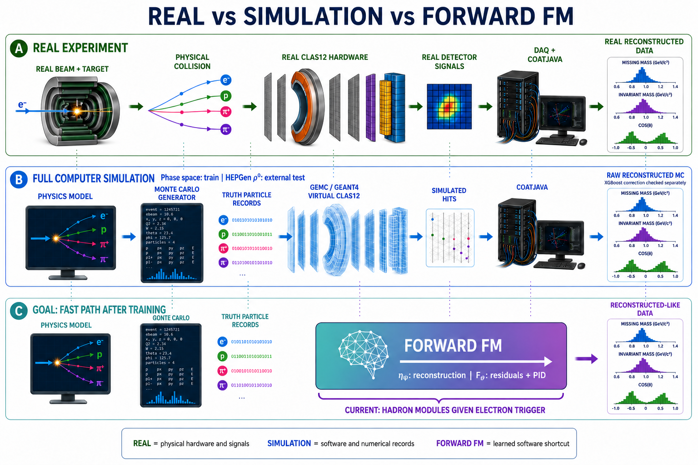

# QuantumMC Forward Foundation Model

The **Forward Foundation Model (Forward FM)** is the project's reusable neural
surrogate for detector simulation and reconstruction. Fix detector/reconstruction
settings $\kappa$. Its intended stochastic map is

$$
\mathcal M_{\Theta,\kappa}:\mathcal G\longrightarrow\mathcal P(\mathcal Y),
\qquad
G\longmapsto\widehat K_\Theta(\cdot\mid G,\kappa).
$$

Here $\mathcal G$ is generated-event space and $\Theta$ collects surrogate
parameters, including the current $\psi,\vartheta$. $G=(g_i)$ contains particle species, momenta and
vertices; $\mathcal Y$ is the reconstructed-record space, including trigger,
reconstruction failures, kinematics and PID. $\mathcal P(A)$ denotes probability
laws on $A$. The target is the combined GEMC/GEANT4 + COATJAVA response
$K_\kappa$. Physics generators supply $G$ independently; the intended foundation
property is reuse across physics processes at fixed detector settings.

**This branch implements 2 hadron modules of that surrogate:**

$$
\eta_\psi:\mathbb R^5\times\mathcal S\longrightarrow\Delta^4,
\qquad
F_\vartheta:\mathbb R^5\times\mathcal S
\longrightarrow\mathcal P(\mathbb R^4)\times\Delta^{|\mathcal R|-1}.
$$

$\mathcal S=\lbrace\pi^-,\pi^+,p\rbrace$; $\mathcal R$ is the reconstructed-PID
vocabulary, including `OTHER`; $\Delta^k$ is the probability simplex.
$\eta_\psi$ predicts reconstruction outcomes; $F_\vartheta$ predicts selected-FD
residual distributions and PID probabilities. Lowercase $\psi,\vartheta$ are
learned weights; uppercase $\Psi,\Phi$ below are input feature maps.



The 3-row diagram retains the original experimental/simulation workflow.
Phase space trains the modules; exclusive rho supplies an external test.
Row C and its spectra are schematic goals. Complete event-level composition
has not yet been validated.

## 1. Physics and reference samples

| ID | Name | Generated events | Role |
|---|---|---:|---|
| R | Response phase space | 5,000,000 | Broad particle kinematics; existing FD response checkpoints |
| M | Mutual-match phase space | 19,820,000 | All-generated-particle export; reciprocal reconstruction gates |
| $\rho$ | Exclusive rho production | 19,920,000 | Independent process-transfer test; 79,680,000 particle rows |

Alex's HEPGen++ sample describes

$$
e^-p\rightarrow e^{\prime-}p'\rho^0\rightarrow e^{\prime-}p'\pi^+\pi^-,
\qquad k+P=k'+P'+p_++p_-.
$$

$k,P$ are incoming electron/proton 4-momenta; $k',P'$ are outgoing;
$p_+,p_-$ are pion 4-momenta. Beam energy: 10.6041 GeV. Proton dissociation
is disabled; no additional QED-radiation option was enabled. All 4 particles
share uniform vertex $-5.5\leq z_{\rm gen}\leq0.5$ cm. Generator soft ranges
are not strict accepted-event boundaries. Exclusivity holds for generated
4-vectors; reconstruction must retain detector smearing.

The rho export preserves all generated rows from 1,992 successful jobs,
including trigger/reconstruction failures; 8 failed jobs are absent. Samples M
and rho share GEMC 5.13 / COATJAVA 10.0.7 settings and reciprocal-match labels.
Sample R has different skim/trigger conventions. **HEPGen weights are missing:**
all reported results are unweighted MC; physical yields and weighted efficiencies
need the LUND weights and event mapping.


## 2. Implemented conditional laws

For native M/rho exports, let $R_i=1$ mean mutual MC-to-REC-to-the-same-MC association, and let
$C_i\in\lbrace0,\mathrm{FD},\mathrm{FT},\mathrm{CD},\mathrm{other}\rbrace$ be the
outcome, with $C_i=0$ when $R_i=0$. PID agreement is not required.
For event $E$, $a_i$ marks association with its first negative-status REC row;
$s_i$ denotes generated species. The electron-associated FD trigger proxy is

$$
T_e(E)=\mathbf1\lbrace\exists i\in E:
s_i=e^-,\quad a_i=1,\quad C_i=\mathrm{FD}\rbrace.
$$

Select `is_trigger_particle == 1`, `pid_gen == 11`, `detector == 1`, then
broadcast by `(file_id,event)`. Reconstructed PID need not be 11. Full-rho
rates: 32.74% for $T_e$, 30.43% with reconstructed-electron PID additionally
required, versus 74.26% for the broader native `triggered` flag.

Use $c=1$, GeV, radians and cm. For generated particle $g$, write momentum
$p$, angles $(\theta,\phi)$, vertex $z$ and species mass $m_s$; subscript $r$
denotes reconstruction. Define $\bar p=p/(1\mathrm{GeV})$ and

$$
\beta_g=\frac{p}{\sqrt{p^2+m_s^2}},\qquad
\Phi(g)=(\log(1+\bar p),\theta,\sin\phi,\cos\phi,\beta_g),
$$

$$
\Psi(g)=(\log(1+\bar p),\theta,\sin\phi,\cos\phi,z).
$$

Both modules use **5 continuous inputs + species** and saved training scalers.
The efficiency module, trained on M, estimates

$$
\eta_{\psi,j}(\Psi(g),s)\approx P_{\rm M}(C_i=j\mid\Psi(g),s,T_e=1),
\qquad \epsilon_{\rm FD}=\eta_{\psi,\rm FD},\quad
\epsilon_{\rm any}=1-\eta_{\psi,0}.
$$

Every generated hadron with $T_e=1$ enters its denominator. For the response
module, define quality selection $H$ and

$$
Q_d=P_d(\Delta,r\mid\Phi(g),s,T_d=1,C=\mathrm{FD},H=1),
\qquad d\in\lbrace\mathrm{R},\rho\rbrace,
$$

$$
\Delta=(p_r-p,\theta_r-\theta,
\mathrm{wrap}_{[-\pi,\pi)}(\phi_r-\phi),\beta_r-\beta_g),
\qquad r=\mathrm{PID}_{\rm rec}.
$$

Frozen $F_\vartheta$ fits response/PID marginals of $Q_{\rm R}$ and is tested
against $Q_\rho$; $T_{\rm R}$ is the saved response-reference trigger proxy,
$T_\rho=T_e$. The adapter converts native degrees and GEN−REC to radians and
REC−GEN. `detector=0` also includes matched FT/other outcomes.

The current modules are **not yet a complete composition of $\mathcal M$**:
the gate and response selections differ. Integrated electron/trigger response,
non-FD response, selection $H$ and event correlations remain to be reconciled.

## 3. Current transfer results

Both platforms use identical inputs and 3 seeds. Gates use M training/validation
only; response checkpoints remain frozen. Rho never enters fitting or model
selection. Tables show mean ± seed SD; pp means percentage points.

**Conditional PID closure:** observed class fractions versus mean softmax
probabilities in common 1-GeV bins. H100 correct-ID MAE:

| Species | Momentum [GeV] | Response phase space [pp] | Rho [pp] |
|---|---:|---:|---:|
| $\pi^-$ | 0–9 | 1.18 ± 0.24 | 1.19 ± 0.08 |
| $\pi^+$ | 0–9 | 1.30 ± 0.26 | 2.92 ± 0.56 |
| Proton | 0–3 | 0.33 ± 0.15 | 1.44 ± 0.13 |


**FD efficiency calibration:** ECE over 20 probability bins; the final column
restricts H100 evaluation to the training coordinate box.

| Species | Mutual-match phase space [pp] | Rho/H100 [pp] | Rho/GB10 [pp] | Rho/in-box [pp] |
|---|---:|---:|---:|---:|
| $\pi^-$ | 1.17 ± 0.22 | 4.39 ± 0.60 | 4.44 ± 0.44 | 3.32 ± 0.34 |
| $\pi^+$ | 0.64 ± 0.09 | 5.41 ± 0.40 | 5.42 ± 1.10 | 1.05 ± 0.29 |
| Proton | 0.59 ± 0.06 | 1.83 ± 0.12 | 1.81 ± 0.12 | 1.94 ± 0.15 |


Outside-box fractions: 15.5%, 17.1%, 7.2%. Pion FD efficiency is overpredicted
below the phase-space $5^\circ$ boundary. Box membership does not establish
joint coverage; omitted event context may also contribute. Common momentum
bins do not remove angular/trigger differences between samples.

Frozen H100/GB10 inference agrees within $8.94\times10^{-7}$ in PID probability.
Independent gate fits reproduce the same transfer pattern; hardware replication
does not add independent MC statistics.

## 4. Raw versus corrected reference

Alex's phase-space-trained XGBoost models predict

$$
f_s:(p_0,\theta_r,\phi_r)\mapsto\widehat{p-p_0},\qquad
p_c=p_0+f_s,\quad \mathbf p_c=(p_c/p_0)\mathbf p_0,
$$

where $p_0$ is raw COATJAVA momentum. Generated PID routes the model;
truth-based eligibility selects a core FD subset. PID, direction and beta are
unchanged; no rows are removed. Frozen FM predictions target **raw** response;
corrected MC is a separate diagnostic on identical particles.

$$
M_{\pi\pi}^2=(p_++p_-)^2,\qquad
M_X^2=(k+P-k'-P'-p_+-p_-)^2.
$$


For 5,934 common selected events, $M_{\pi\pi}$ median shifts
0.7516→0.7538 GeV, versus generated 0.7830 GeV. Broad tails remain.
These are unweighted MC correction checks with truth-species masses;
FM-generated exclusive-event closure has not been tested.

## 5. Status and performance criterion

**Status: meaningful hadron-component transfer, with diagnosed limitations.**
Negative-pion PID transfers well; positive-pion/proton PID gaps remain.
Efficiency transfer exposes inadequate coverage, especially below $5^\circ$.
Next: broaden phase-space coverage, study remaining in-domain errors and
response tails/correlations, compose selections and electron/trigger modules,
then test weighted event observables and additional independent processes.

The technical criterion is **conditional detector-response closure**;
testing an independent process measures **transfer closure**. It must reproduce
detector inefficiencies, misidentifications and smearing. Assess:

- Efficiency: probability calibration, Brier score, kinematic closure.
- PID: full migration probabilities, total variation and correct-ID MAE.
- Continuous response: bias, widths, tails and correlations.
- Composed events: selection efficiencies, $M_{\pi\pi}$, $M_X^2$ and analysis observables.

For generator $d$ and declared observable or bin indicator $A(Y)$, define

$$
b_{d,A}=\mathbb E_{{\rm FM},d}[A(Y)]-\mathbb E_{{\rm MC},d}[A(Y)].
$$

Let $U_{d,A}$ be an uncertainty upper bound on $|b_{d,A}|$ at a declared
confidence level, including relevant statistical/model uncertainty. Require
$U_{d,A}\leq\delta_{d,A}$ for predeclared analysis tolerance $\delta_{d,A}$.
There is no universal MAE/ECE cutoff; finite-sample non-rejection is insufficient.
Reusable foundation behavior additionally needs transfer across relevant
processes/species and a useful simulation speed advantage. This branch has
not yet established full event closure or that generality. Full-MC agreement
with measured data remains a separate calibration question.
See [modular detector-surrogate validation](https://arxiv.org/abs/2309.13213)
and [physics-analysis validation](https://arxiv.org/abs/2310.08994).

## Appendix: reproduction

Base: `main` at `56c5e19`; gate machinery: `4674686`.
[Protocol, scores, architecture and seeds](docs/TRANSFER_PROTOCOL.md).
Whole-event inputs: 1,990,439 rho and 1,980,434 M events (10% samples).
R control: 500,438 held-out events → 158,985 selected response particles.
Gates use 300,000/50,000/100,000 train/validation/test rows per species;
rho tests use up to 100,000 particles/species. Physics plots sample 100,000
complete events/source. Software: H100/PyTorch 2.13, GB10/PyTorch 2.14,
CUDA 13.0, DuckDB 1.5.6. No electron network is fitted here. Inverse-asinh
draws are unbounded; extreme/negative-momentum draws are counted without clipping.

```bash
python -m pip install -r requirements.txt pytest
python -m pip install duckdb==1.5.6
python -m pytest -q
python experiments/prepare_transfer_data.py --rho RHO.parquet \
  --phase MUTUAL_MATCH_PHASE_SPACE.parquet \
  --response-glob 'RESPONSE_PHASE_SPACE/*.parquet' --output INPUTS
python experiments/audit_transfer_data.py --inputs INPUTS --output audit.json
python experiments/run_transfer_study.py --inputs INPUTS \
  --output runs/rho_transfer/PLATFORM --device cuda:0
python experiments/plot_transfer_physics.py --rho INPUTS/rho.parquet \
  --phase INPUTS/phase.parquet --output runs/rho_transfer/physics
python experiments/analyze_transfer_study.py --runs runs/rho_transfer \
  --output runs/rho_transfer/summary
```

[Seed summaries](runs/rho_transfer/summary/summary.json),
[common-bin scores](runs/rho_transfer/summary/response_common_bins_summary.csv),
[calibration](runs/rho_transfer/summary/hadron_efficiency_calibration.png),
[central response/tails](runs/rho_transfer/summary/central_momentum_response.png),
and [physics cutflow](runs/rho_transfer/physics/physics_summary.json) accompany
the figures. Original artifact IDs are retained for reproducibility.
New gate checkpoints/event predictions remain on both experiment hosts;
aggregate results, figures and logs are versioned.
