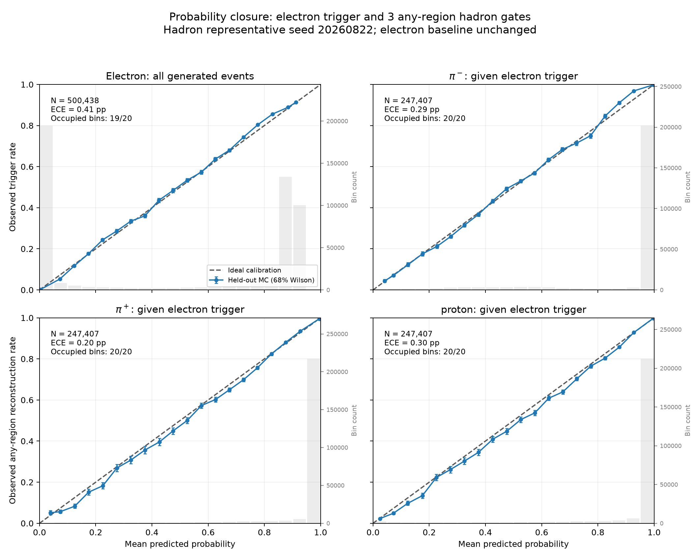
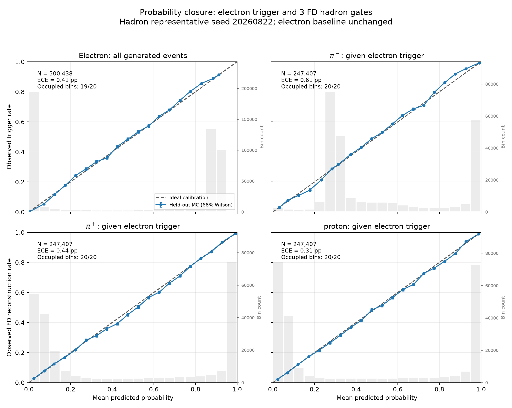
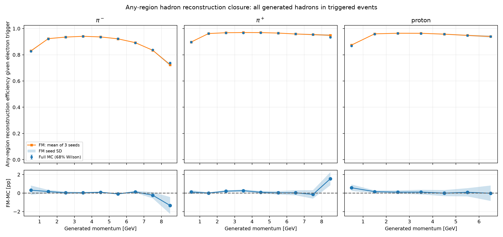
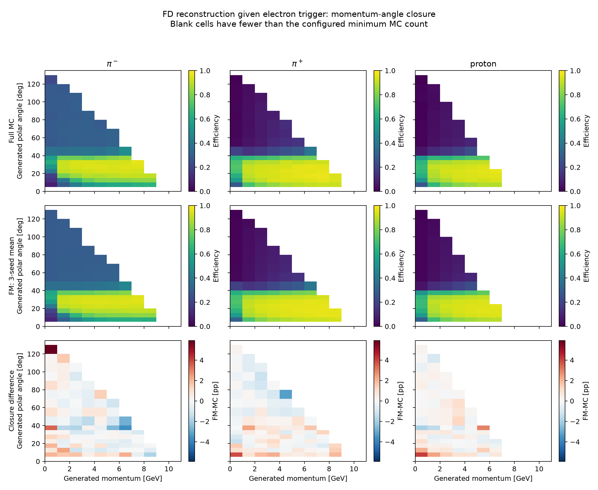

# QuantumMC Forward Foundation Model

For generated hadron species $s\in S=\lbrace-211,211,2212\rbrace$, learn

$$
q_\vartheta:\mathbb R^5\times S\longrightarrow\Delta^4,
\qquad
\Delta^4=\lbrace q\in[0,1]^5:\sum_{c=0}^{4}q_c=1\rbrace.
$$

Here $q$ is a distribution over 5 skim-defined reconstruction outcomes,
conditional on a valid electron trigger. This branch,
`feature/trigger-conditioned-hadron-efficiency`, extends
[the electron/four-species baseline](https://github.com/HHTseng/QuantumMC_Forward_Foundation_Model/tree/feature/trigger-electron-efficiency-four-species)
with 3 independent hadron efficiency models. The electron and residual/PID
models are unchanged.

## Physics and data

Let $T$ denote `has_valid_trigger_electron`, and let
$x=(p,\theta,\phi,v_z)$ be generated momentum, polar angle, azimuth, and
longitudinal vertex. Numerical units are GeV, radians, and cm. The 5 active
truth inputs are

$$
\Phi(x)=(\log(1+p),\theta,\sin\phi,\cos\phi,v_z),
\qquad z=Z_{\rm train}(\Phi(x)).
$$

$Z_{\rm train}$ is fitted separately per species on training rows only. The constant transverse
vertices are recorded but omitted. There are no reconstructed inputs and no
$\beta$ input in these efficiency models.

For each generated particle, define the ordered outcome vocabulary
$C\in(\mathrm{unreconstructed},\mathrm{FD},\mathrm{FT},\mathrm{CD},\mathrm{other})$.
A reconstruction requires `reconstructed` and a nonnull, nonnegative
`matched_pindex`; its detector-region label then determines $C$.

$$
q_\vartheta(c\mid z,s)\simeq P(C=c\mid x,s,T=1),
$$

$$
\eta_{\rm any}=1-q_{\rm unreconstructed},
\qquad
\eta_{\rm FD}=q_{\rm FD},
\qquad
0\leq\eta_{\rm FD}\leq\eta_{\rm any}\leq1.
$$

The intended next task is **per-species acceptance/reconstruction closure given
an electron trigger**, not another hardware-trigger model. The denominators are:

| Component | Denominator | Positive outcome |
|---|---|---|
| Electron reference | Every generated electron/event | $T=1$ |
| Hadron, any region | Every generated hadron of species $s$ with $T=1$ | $C\ne\mathrm{unreconstructed}$ |
| Hadron, FD | Same triggered hadron population | $C=\mathrm{FD}$ |

A wrong reconstructed PID remains a reconstruction success. No PID, beta,
reciprocity, fiducial, or residual cut removes denominator rows. Correct-PID
efficiency is a different, subsequent quantity.

The Aug17-26 Parquet production contains 5,000,000 events and 1 generated
electron, $\pi^-$, $\pi^+$, and proton per event. Each hadron denominator has
2,471,543 triggered rows: 1,976,265 train, 247,871 validation, 247,407 test.
The composite key `(source_file_id, event_id)` fixes event-disjoint partitions.
Hadron generation covers approximately 0.3–9 GeV (pions), 0.3–7 GeV (protons),
and $5^\circ\leq\theta\leq130^\circ$; substantial CD reconstruction is retained.

This separation follows [CLAS12 reconstruction before PID](https://eprints.gla.ac.uk/208714/1/208714.pdf)
and the acceptance → efficiency → resolution → PID organization of
[Lamarr](https://arxiv.org/abs/2309.13213).
The broad generated-electron acceptance probability here is not the
eligible-electron hardware efficiency discussed in
[CLAS12 trigger studies](https://eprints.gla.ac.uk/298277/1/298277.pdf).
The [design and evidence](docs/HADRON_EFFICIENCY_DESIGN.md) distinguish the
inferred task from a verbatim recovered instruction.

## Held-out results

Each species has 3 training seeds on the same held-out events. Tables show
mean ± sample SD across seeds, not test-sample uncertainty. Efficiencies are
percent; calibration errors are percentage points (pp).

| Particle / outcome | Full MC (%) | FM mean probability (%) | ECE (pp) |
|---|---:|---:|---:|
| Electron / trigger, unchanged reference | 49.44 | 49.21 | 0.41 |
| $\pi^-$ / any region | 90.64 | 90.72 ± 0.17 | 0.37 ± 0.08 |
| $\pi^+$ / any region | 95.31 | 95.43 ± 0.10 | 0.20 ± 0.05 |
| Proton / any region | 94.06 | 94.25 ± 0.12 | 0.37 ± 0.06 |



The electron panel uses 500,438 test events; each hadron panel uses its
247,407-event triggered subset. Exact event-key matching and frozen-electron
checkpoint replay [pass](runs/hadron_efficiency/summary/electron_reference_validation.json).
Reliability plots use a fixed representative seed; the tables summarize all 3.

| Generated species, FD | Full MC (%) | FM (%) | ECE (pp) | Weighted $(p,\theta)$ closure MAE (pp) |
|---|---:|---:|---:|---:|
| $\pi^-$ | 52.16 | 52.13 ± 0.44 | 0.64 ± 0.06 | 0.84 ± 0.06 |
| $\pi^+$ | 45.50 | 45.56 ± 0.09 | 0.47 ± 0.12 | 0.64 ± 0.06 |
| Proton | 43.13 | 43.36 ± 0.06 | 0.40 ± 0.10 | 0.62 ± 0.11 |



For a kinematic bin $B$, compare observed fractions with averaged probabilities,
not thresholded classifications:

$$
\widehat\eta_{\rm MC}(B)=\frac{\sum_{i\in B}R_i}{N_B},
\qquad
\widehat\eta_{\rm FM}(B)=\frac{\sum_{i\in B}\eta_i}{N_B}.
$$

$R_i$ is the chosen FD or any-region reconstruction indicator. Reliability
instead groups particles into 20 fixed predicted-probability bins. With bin
means $\bar\eta_b,\bar R_b$ and counts $n_b$,

$$
\mathrm{ECE}=\sum_b\frac{n_b}{N}\left|\bar\eta_b-\bar R_b\right|.
$$





The models learn substantially more than the global rate: relative to a
constant training-rate predictor, test Brier scores decrease by
57.0/47.5/57.3% for any-region and 37.3/72.4/75.8% for FD
($\pi^-,\pi^+,\mathrm{proton}$).
Global calibration is not uniform closure: supported 2D cells still differ by
several pp; the largest individual-run FD discrepancy is 8.2 pp.
Sparse/empty probability bins do not establish calibration outside their support.

All 1D/2D bins and counts are saved. Kinematic summaries require at least
100 particles per bin; MC error bars are 68% Wilson intervals and shaded
bands show training-seed SD. See
[full metrics](runs/hadron_efficiency/summary/condition_summary.csv),
[per-run metrics and hashes](runs/hadron_efficiency/summary/per_run_metrics.csv),
[angle closure](runs/hadron_efficiency/summary/hadron_efficiency_vs_gen_theta.png),
and [any-region 2D closure](runs/hadron_efficiency/summary/hadron_efficiency_p_theta_any.png).

## Interpretation and limits

These are **closure tests of the stored skim associations**, not measured
intrinsic tracking efficiencies. The
[label audit](runs/hadron_efficiency/summary/matching_diagnostics.csv)
finds shared reconstructed candidates for 18.88/15.66/15.01% of the triggered
generated $\pi^-/\pi^+/\mathrm{proton}$ rows. Nonreciprocal matches also remain.
These diagnostics are not cuts; shared associations need physics review before
interpreting every positive label as a unique reconstructed particle.

The inherited FD residual/PID model additionally conditions on a selection
$F=1$ (fiducial/quality and residual cuts). This branch does not learn
$P(F=1\mid C=\mathrm{FD},T=1,x,s)$ or CD/FT residuals. The new gates and old
response therefore are not yet a complete, selection-matched event simulator.
No new beta response or Joo split-momentum response is introduced here.

Single-particle models omit event context and correlations. Products of
marginal efficiencies do not establish joint event closure. Different
generators, occupancies, or detector conditions require new validation; 3
network seeds do not quantify these systematic uncertainties.

## Use and reproduction

```bash
python -m unittest discover -s tests -v

# After obtaining a checkpoint: generated-only input, radians and cm.
python predict_hadron_efficiency.py \
  --checkpoint runs/hadron_efficiency/seed_20260822/pid_211/model.pt \
  --input docs/examples/generated_pi_plus.csv --output predictions.csv

# Rebuild figures/tables from committed aggregate results, without retraining.
python experiments/analyze_hadron_efficiency.py --aggregate-only
```

The published [study directory](runs/hadron_efficiency) includes validation/test
metrics, binned results, checkpoint hashes, resolved configurations, histories,
logs, and audits. All 9 checkpoints and event-level test predictions are
retained on the experiment hosts, but are not included in this public export.
Aggregate-only plotting uses their recorded hashes, not a new raw-file check.
Existing checkpoints are never overwritten.

### Appendix: recipe and provenance

The categorical objective is unweighted cross-entropy,
$\mathcal L=-N^{-1}\sum_i\log q_{\vartheta,C_i}(z_i,s)$.
Checkpoints minimize validation loss; the test set is not used for selection.
Each species uses 4 width-256 SiLU/LayerNorm layers, dropout 0.03, and one
5-class head; AdamW, learning rate 0.001, weight decay 0.00001, batch 16,384,
30 epochs, patience 6. All 9 runs completed 30 epochs.
Fixed split seed: `20260822`; network seeds: `20260822/20260823/20260824`.
Training source: `a0f56ed`; each checkpoint records source hashes and scalers.
No hyperparameter search or test-set tuning was performed for this baseline.

Training ran on H100 GPUs in persistent `tmux` sessions. One unavailable-GPU
attempt was preserved under `failed_attempts` and rerun unchanged on another
GPU. GPU/seed assignment does not change the data split or model recipe.

```bash
# Fresh experiments use a new directory; quoted glob must include all files.
python experiments/run_hadron_efficiency.py --root runs/hadron_efficiency_repeat \
  --parquet-glob '/path/to/particle_responses/*.parquet' --device cuda:0

python experiments/verify_electron_reference.py --root runs/hadron_efficiency_repeat \
  --parquet-glob '/path/to/particle_responses/*.parquet'
python experiments/analyze_hadron_efficiency.py --root runs/hadron_efficiency_repeat

python experiments/audit_hadron_labels.py \
  --parquet-glob '/path/to/particle_responses/*.parquet'
```

See [configuration](configs/hadron_efficiency.yaml), the
[reference-integrity report](runs/hadron_efficiency/summary/electron_reference_consistency.json),
and [test log](runs/hadron_efficiency/summary/tests_tara.log).
