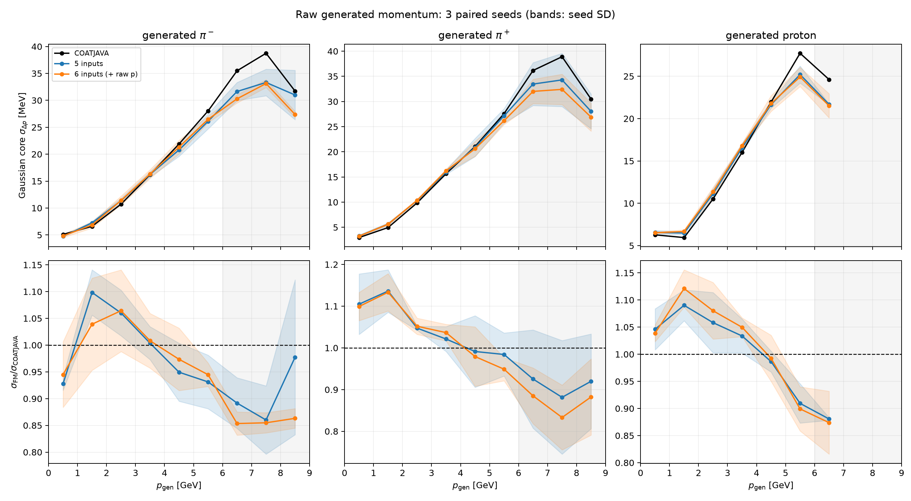
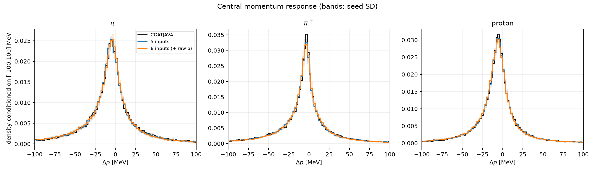

# QuantumMC Forward Foundation Model

`main` implements Dr. Joo's split-momentum response with an optional raw-momentum
input. For generated species $\mathcal S:=\lbrace-211,211,2212\rbrace$ and reconstructed
PID vocabulary $\mathcal R$, the neural network defines

$$
F_\vartheta:\mathbb R^d\times\mathcal S
\longrightarrow\mathcal P(\mathbb R^4\times\mathcal R),\qquad d\in\lbrace5,6\rbrace.
$$

Here $\mathcal P(A)$ denotes probability laws on $A$. The output is a sampled
detector response and reconstructed PID, conditioned on a valid trigger and
successful Forward Detector (FD) reconstruction.

## Coordinates and response

Let $x=(p,\theta,\phi,s)$ be generated momentum, polar angle, azimuth, and
species. Units are GeV and radians. With generated-species mass $m_s$,

$$
\beta_{\rm gen}=\frac{p}{\sqrt{p^2+m_s^2}},\qquad
\Phi_5(x)=(\log(1+p),\theta,\sin\phi,\cos\phi,\beta_{\rm gen}),
$$

$$
\Phi_6(x)=(\Phi_5(x),p),\qquad z=Z_{\rm train}(\Phi_d(x)).
$$

Species enters categorically; only the $d$ continuous coordinates are
standardized using training statistics. Raw $p$ adds a useful coordinate,
although it contains no information absent from $\log(1+p)$.

For a matched reconstructed particle, define

$$
\Delta=(\Delta p,\Delta\theta,\Delta\phi,\Delta\beta),\qquad
\Delta p=p_{\rm rec}-p,\quad \Delta\theta=\theta_{\rm rec}-\theta,
$$

$$
\Delta\phi=\mathrm{wrap}_{[-\pi,\pi)}(\phi_{\rm rec}-\phi),\qquad
\Delta\beta=\beta_{\rm rec}-\beta_{\rm gen}.
$$

The momentum coordinate is

$$
u_p=\mathrm{asinh}(\Delta p/a),\qquad
\Delta p=a\sinh u_p,\qquad a=0.020\ {\rm GeV}.
$$

It resolves the narrow central peak while compressing large residuals.
Writing $y=Z_\Delta(u_p,\Delta\theta,\Delta\phi,\Delta\beta)$, the model fits

$$
q_\vartheta(y,r\mid z,s)
=q_p(y_p\mid z,s)q_o(y_o\mid z,s)\rho_r(z,s),
$$

where $y_p\in\mathbb R$, $y_o\in\mathbb R^3$, $q_p,q_o$ are separate Gaussian
mixtures, and $\rho$ is a categorical PID distribution. Thus momentum and the
other residuals are conditionally independent. Sampling undoes standardization
and asinh before constructing reconstructed kinematics.

## Data and fitted scope

| Object | Columns or definition |
|---|---|
| Generated inputs | `gen_pid, gen_p, gen_theta, gen_phi` |
| Derived inputs | $\beta_{\rm gen}$; optionally raw $p$ |
| Continuous labels | `delta_p, delta_theta, delta_phi`; $\Delta\beta$ from `rec_beta` |
| Categorical label | `rec_pid`; PID mismatches are retained |
| Species | $\pi^-,\pi^+,p$ |
| Unknown reconstructed class | `OTHER`, outside the training PID vocabulary |

The fitted law is $P(\Delta,r\mid x,T=1,C={\rm FD},F=1)$, where $T$ is the
trigger proxy, $C$ the reconstruction region, and $F$ the quality selection.
The original selection uses reconstructed $\theta<33^\circ$, generated vertex
$-5.5<z_{\rm gen}<-0.5$ cm, reciprocal matching, nonzero reconstructed PID,
`rec_beta > -99`, finite residuals, and $\lvert\Delta p\rvert\leq10$ GeV.
It does not apply the later branch's $0<\beta_{\rm rec}\leq1.2$ restriction.

The event key `(source_file_id, event_id)` determines the fixed 80/10/10 split.
`assert_event_disjoint` checks all partition intersections; `build_audit` records
selection, cutflow, duplicate keys, data fingerprint, and particle-order hashes.
Both missing functions from the attachment are restored in `data_asinh_dp.py`.

## Evaluation and raw-momentum comparison

Checkpoints minimize validation joint loss

$$
\mathcal L=-\mathbb E\log q_p-\mathbb E\log q_o
-\lambda_{\rm PID}\mathbb E\log\rho_r,\qquad\lambda_{\rm PID}=1.
$$

Loss values use standardized model coordinates. Physical closure is evaluated
after inversion. Core medians and $\sigma_{68}=(q_{84}-q_{16})/2$ condition on
$\lvert\Delta p\rvert\leq100$ MeV, matching the poster. Gaussian core fits use
Dr. Joo's 1-MeV histograms and two-stage fitting window.

The paired experiment compares $d=5$ and $d=6$ on identical particles and starts
both models from the same function: the added raw-$p$ weight is initially zero.
The primary diagnostic is mean $\lvert\sigma_{\rm FM}/\sigma_{\rm CJ}-1\rvert$
over the 6 populated pion bins at 6--9 GeV. All 6 runs completed the fixed
epoch budget and have identical particle-order hashes. Each test uses 158,985
particles. Mean and sample SD across 3 paired model seeds are:

| Metric | 5 inputs | 6 inputs (+ raw $p$) |
|---|---:|---:|
| Validation high-momentum width error (%) | 10.50 ± 4.65 | 11.60 ± 4.35 |
| Test high-momentum width error (%) | 12.23 ± 2.73 | 13.80 ± 3.60 |
| Test mean absolute core median bias [MeV] | 0.485 ± 0.222 | 0.502 ± 0.245 |
| Test particle-weighted PID TV | 0.02601 ± 0.00125 | 0.02748 ± 0.00184 |
| Test macro $W_1(\beta_{\rm rec})$ | 0.02764 ± 0.00493 | 0.02855 ± 0.00335 |

Raw $p$ improves the primary test score in 1/3 pairs; its mean error increases
by 1.57 percentage points (12.9% relative). It does not provide a consistent
benefit under this recipe. The 5-input configuration remains the reference.
These 3 pairs describe seed variation; they are not a high-precision
significance study.





Core closure does not establish full-tail closure. The unbounded inverse-asinh
distribution generated rare extreme residuals, including a retained validation
draw of $2.34\times10^{14}$ GeV. No draw was clipped or removed. The
[tail audit](runs/raw_momentum_ablation/summary/tail_audit.csv) records maxima,
quantiles, and counts beyond 10 GeV for every run. Sampling reports
`sample_abs_delta_p_gt_10GeV` and `sample_is_physical`; support-aware tail
modeling is still needed before event-level physics use.

Full [summary](runs/raw_momentum_ablation/summary/summary.json),
[per-run metrics](runs/raw_momentum_ablation/summary/per_run_metrics.csv),
[paired differences](runs/raw_momentum_ablation/summary/paired_differences.csv),
and [checkpoint hashes](runs/raw_momentum_ablation/summary/provenance.csv) are saved.

PID closure compares observed reconstructed-class fractions with mean softmax
probabilities in fixed momentum bins, using total variation over all classes.
It is distinct from top-1 classification accuracy.

## Use

```bash
conda create -n QuantumMC python=3.11 -y
conda activate QuantumMC
python -m pip install -r requirements.txt
python -m unittest discover -s tests -v

# 5 inputs; append --raw-momentum for 6 inputs and a separate run directory.
python train.py --config configs/gpu_split_dp_asinh.yaml \
  --parquet-glob '/path/to/particle_responses/*.parquet' \
  --run-dir runs/split_dp_5 --device cuda:0

python sample.py --checkpoint runs/split_dp_5/model.pt \
  --input example_generated_hadrons.csv --output artifacts/response.csv \
  --seed 20261003 --device cpu
```

`train_split_dp_asinh.py` and `sample_split_dp_asinh.py` are explicit equivalents.
Format-2 checkpoints store the transform scale, masses, feature/target order,
scalers, selection, data seeds, and source hashes. Legacy configurations and
format-1 checkpoints retain their original training/sampling path.

## Appendix: implementation and experiment provenance

The shared backbone has 4 layers of width 256, SiLU/LayerNorm, dropout 0.03,
and a species embedding of dimension 16. Each response head has 8 components.
The reference recipe uses AdamW, learning rate 0.001, weight decay 0.00001,
batch size 8192, and 30 epochs. Checkpoint selection uses validation loss only.

Model seeds are `20260822, 20260823, 20260824`; event split and particle order
remain fixed at `20260822`. The preloaded GPU path preserves the reference
DataLoader batch order. Sampling uses the author's CPU seed `20261003`.

For each condition, run one worker; use different GPUs for concurrent workers:

```bash
python experiments/run_raw_momentum_ablation.py --condition baseline \
  --parquet-glob '/path/to/particle_responses/*.parquet' --device cuda:0
python experiments/run_raw_momentum_ablation.py --condition raw \
  --parquet-glob '/path/to/particle_responses/*.parquet' --device cuda:1

python experiments/analyze_raw_momentum_ablation.py
python experiments/audit_split_dp_tails.py
```

Training used commit `444fae0`; each checkpoint records its source hashes.
All 6 primary `model.pt` files, logs, resolved configurations, audits, and
evaluations are included under `runs/raw_momentum_ablation/seed_<seed>/`.
The fixed representative seed is `20260822`; its
[5-input checkpoint](runs/raw_momentum_ablation/seed_20260822/baseline/model.pt)
and [6-input checkpoint](runs/raw_momentum_ablation/seed_20260822/raw/model.pt)
can be used directly with `sample.py` after cloning.

This branch models 3-species conditional hadron response. Trigger efficiency
and generated-electron response remain in
[`feature/trigger-electron-efficiency-four-species`](https://github.com/HHTseng/QuantumMC_Forward_Foundation_Model/tree/feature/trigger-electron-efficiency-four-species).
Its electron efficiency imports the legacy `data.py` utilities, which are
unchanged here. Porting the new response to 4 species requires electron mass,
species vocabulary, input scaling, model dimensions, and fresh validation.
Existing 4-species checkpoints cannot be loaded into the split model.
The legacy sampling path was tested against the existing 4-species checkpoint,
including a generated electron; the branch itself was not modified.

Current limitations: diagonal covariance within each mixture component,
conditional independence introduced by the split head, unconstrained physical
draws, no event correlations, and simulation-only validation.
