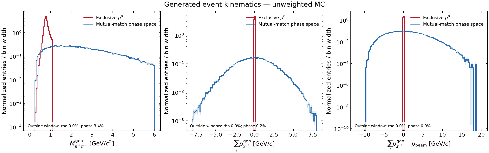
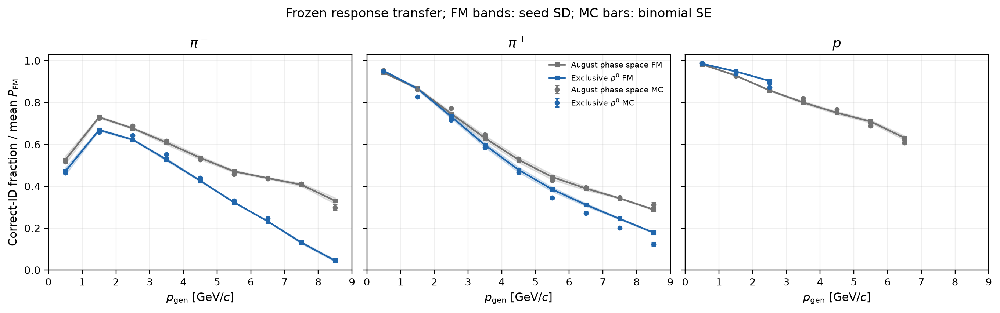
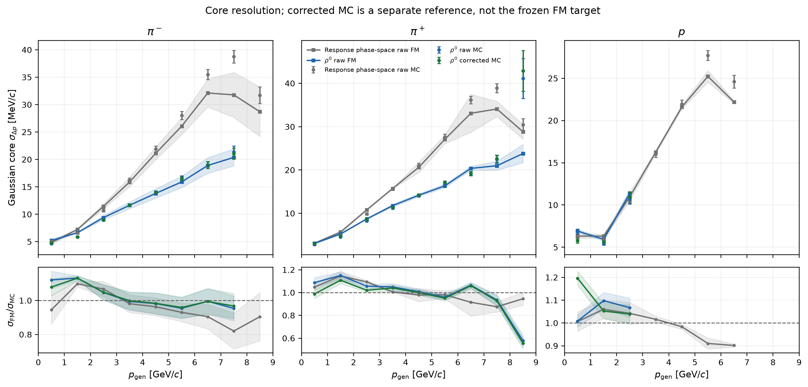
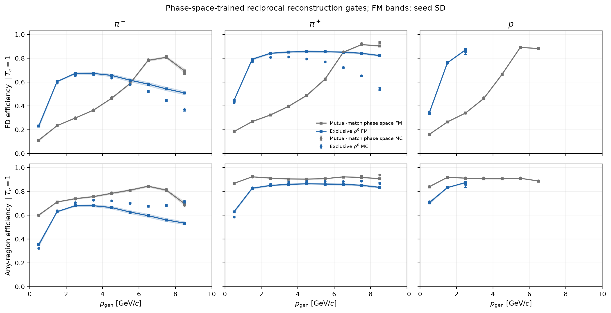
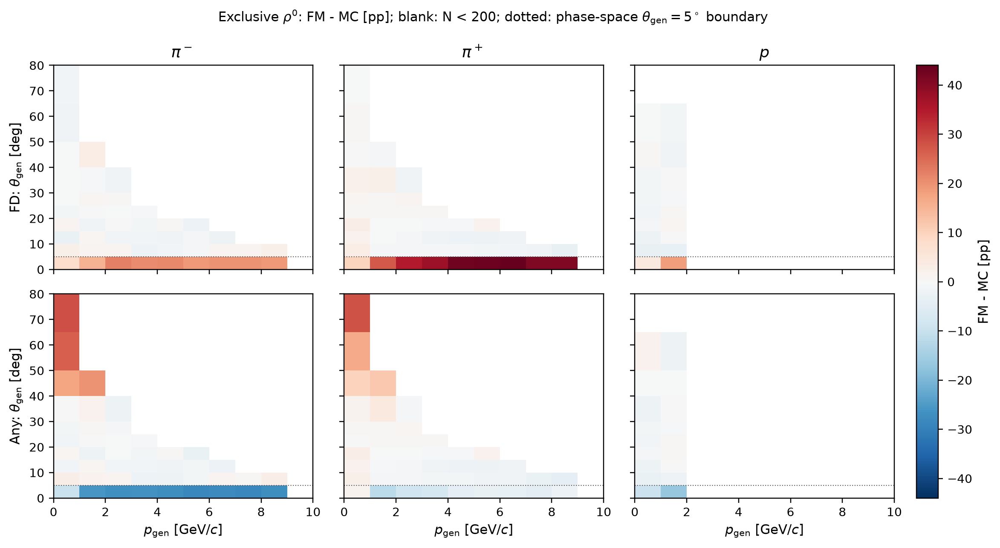
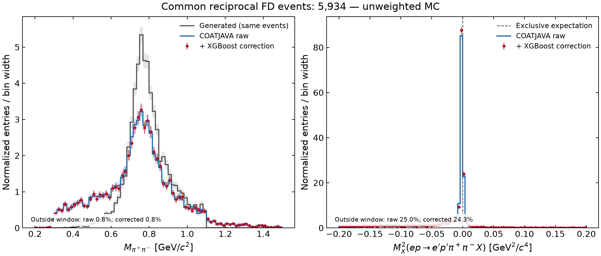

# QuantumMC Forward Foundation Model

Let $\mathcal S=\lbrace\pi^-,\pi^+,p\rbrace$, $\mathcal C=\lbrace0,\mathrm{FD},\mathrm{FT},\mathrm{CD},\mathrm{other}\rbrace$,
and $\mathcal R$ be the checkpoint PID vocabulary, including `OTHER`.
This branch defines neural maps

$$
\eta_\psi:\mathbb R^5\times\mathcal S\longrightarrow\Delta^4,
\qquad
F_\vartheta:\mathbb R^5\times\mathcal S
\longrightarrow\mathcal P(\mathbb R^4)\times\Delta^{|\mathcal R|-1}.
$$

Here $\Delta^k$ is the probability simplex and $\mathcal P(A)$ denotes probability
laws on $A$. The maps estimate reconstruction region and selected FD
response/PID, respectively. Phase space supplies training; exclusive $\rho^0$
production supplies an external transfer test.

## 1. Physics and data

Alex's HEPGen++ sample describes

$$
e^-p\rightarrow e^{\prime-}p'\rho^0\rightarrow e^{\prime-}p'\pi^+\pi^-,
\qquad
k+P=k'+P'+p_++p_-.
$$

Here $k,P$ are incoming electron/proton 4-momenta; $k',P'$ are outgoing;
$p_+,p_-$ are pion 4-momenta. Beam energy: 10.6041 GeV. Proton dissociation is
disabled; no additional QED-radiation option was enabled. The 4 particles share a vertex with uniform
$-5.5\leq z_{\rm gen}\leq0.5$ cm. Generator-card soft ranges are not strict
accepted-event boundaries.

| Sample | Generated events | Purpose |
|---|---:|---|
| August phase space | 5,000,000 | Existing response checkpoints; original held-out control |
| September compact phase space | 19,820,000 | New reciprocal reconstruction gates |
| Exclusive $\rho^0$ | 19,920,000 | External test; 79,680,000 particle rows |

The rho export retains all generated rows from 1,992 successful jobs, including
trigger/reconstruction failures. The 8 failed jobs are absent. September and rho
share GEMC 5.13 / COATJAVA 10.0.7 conditions. Phase-space-trained XGBoost models
add momentum corrections after reconstruction. Exclusivity constrains generated
events; it does not imply uniformly improved detector precision.

HEPGen event weights were **not exported**. All results below use unweighted
MC counts; cross sections, physical yields and physics-weighted efficiencies
require the LUND weights and their event mapping.



## 2. Labels and coordinates

For generated particle $i$, $R_i=1$ means mutual MC-to-REC-to-the-same-MC
association; $C_i=0$ means $R_i=0$. FD/FT/CD denote detector regions. No PID
agreement or matching-quality threshold defines reconstruction.

For event $E$, define the electron-associated FD trigger proxy

$$
T_e(E)=\mathbf1\{\exists i\in E:
i\text{ is the generated electron associated with the selected FD trigger}\}.
$$

The selected trigger is the first negative-status REC row. In columns, select
`is_trigger_particle == 1`, `pid_gen == 11`, `detector == 1`, then broadcast
the event label. Reconstructed PID need not be 11. Native `triggered` means
any negative-status REC row and is a different label: full-rho rates are
74.26% for `triggered`, 32.74% for $T_e$, and 30.43% when additionally requiring
reconstructed PID 11. Event keys are `(file_id,event)`.

Use $c=1$, momenta/masses in GeV, angles in radians, and vertices in cm.
Subscript $r$ denotes reconstruction. For generated momentum $p$, angles $(\theta,\phi)$, vertex $z$ and species mass
$m_s$, set $\bar p=p/(1\,\mathrm{GeV})$ and

$$
\beta_g=\frac{p}{\sqrt{p^2+m_s^2}},\qquad
\Phi=(\log(1+\bar p),\theta,\sin\phi,\cos\phi,\beta_g),
\qquad
\Psi=(\log(1+\bar p),\theta,\sin\phi,\cos\phi,z).
$$

Response uses $\Phi$; efficiency uses $\Psi$. Both have **5 continuous inputs**;
species is categorical. Train-only scalers are retained during transfer.

$$
\eta_{\psi,c}(\Psi,s)\approx P_{\rm Sep}(C_i=c\mid\Psi,s,T_e=1),
\qquad
\epsilon_{\rm FD}=\eta_{\psi,\rm FD},\quad
\epsilon_{\rm any}=1-\eta_{\psi,0}.
$$

Every generated hadron with $T_e=1$ enters the efficiency denominator.
For dataset $d\in\lbrace A,\rho\rbrace$ (August, rho), define the selected response

$$
Q_d=P_d(\Delta,r\mid\Phi,s,T_d=1,C=\mathrm{FD},F=1),
\qquad T_A=T_{\rm August},\quad T_\rho=T_e.
$$

$$
\Delta=(p_r-p,\theta_r-\theta,
\mathrm{wrap}_{[-\pi,\pi)}(\phi_r-\phi),\beta_r-\beta_g),
\qquad r=\mathrm{PID}_{\rm rec}.
$$

Here $F$ is the saved quality selection. The frozen network fits response/PID
marginals of $Q_A$; transfer compares them with $Q_\rho$.
The adapter converts native degrees and GEN−REC residuals to this convention.
`detector=0` includes matched FT/other particles; it is not a failure flag.
The September reconstruction label matches rho, while the August skim has
different association/trigger conventions.

## 3. Transfer results

Both platforms use identical inputs and 3 seeds. Response models are frozen;
gates use September training/validation only. Tables show mean ± seed SD;
pp denotes percentage points.

Conditional PID closure compares reconstructed fractions with **mean softmax
probabilities** in 1-GeV bins. It does not use top-1 accuracy. On common bins,
H100 correct-ID MAE is:

| Generated species | Momentum [GeV] | August [pp] | Rho [pp] |
|---|---:|---:|---:|
| $\pi^-$ | 0–9 | 1.18 ± 0.24 | 1.19 ± 0.08 |
| $\pi^+$ | 0–9 | 1.30 ± 0.26 | 2.92 ± 0.56 |
| Proton | 0–3 | 0.33 ± 0.15 | 1.44 ± 0.13 |

Negative-pion PID transfers well; positive-pion/proton gaps remain. Common bins
align momentum ranges, while angular populations and trigger contracts still
differ. The comparison does not isolate the generator's effect.





The gates show a stronger transfer limitation. H100 FD calibration error (ECE,
20 probability bins) and the GB10 replication are:

| Species | September ECE [pp] | Rho ECE [pp] | Rho ECE, GB10 [pp] | Rho ECE inside training box [pp] |
|---|---:|---:|---:|---:|
| $\pi^-$ | 1.17 ± 0.22 | 4.39 ± 0.60 | 4.44 ± 0.44 | 3.32 ± 0.34 |
| $\pi^+$ | 0.64 ± 0.09 | 5.41 ± 0.40 | 5.42 ± 1.10 | 1.05 ± 0.29 |
| Proton | 0.59 ± 0.06 | 1.83 ± 0.12 | 1.81 ± 0.12 | 1.94 ± 0.15 |

Outside-box fractions: 15.5%, 17.1%, 7.2%. Pion FD efficiency is overpredicted
below the phase-space $5^\circ$ boundary. Broader coverage should precede
rho-specific tuning; box membership alone does not establish joint coverage.
Residual in-box gaps may also reflect event correlations omitted from the inputs.





Frozen H100/GB10 inference uses identical checkpoints and teacher particles;
maximum PID-probability difference is $8.94\times10^{-7}$. Independently trained
gates reproduce the same transfer pattern. GPU/software replication is not
additional independent MC statistics.

## 4. Raw and corrected response

Let $p_0$ be original COATJAVA momentum. Alex's species-specific XGBoost map is

$$
f_s:(p_0,\theta_r,\phi_r)\mapsto\widehat{p-p_0},\qquad
p_c=p_0+f_s,\qquad \mathbf p_c=(p_c/p_0)\mathbf p_0.
$$

Application requires mutual FD reconstruction, $-5.5<z_r<0.5$ cm,
$|p-p_0|<0.15$ GeV, finite valid inputs and positive momenta; electrons also
require $p_0>2$ GeV. Generated PID routes the model. PID, direction and
$\beta_r$ remain unchanged. All rows survive; `was_corrected` records application.
The 4 model hashes match the manifest; 10,788 sampled corrected momenta were
reproduced exactly at stored float32 precision.

Frozen FM predictions target **raw** response. Corrected MC is shown as a
separate reference on the same particles. In the 5,934 common fully matched FD
events below, the pion-pair median moves 0.7516→0.7538 GeV; the same-event
generated median is 0.7830 GeV. Broad tails remain.

$$
M_{\pi\pi}^2=(p_++p_-)^2,\qquad
M_X^2=(k+P-k'-P'-p_+-p_-)^2.
$$



These are unweighted correction diagnostics with truth-species masses.
Correlated FM event closure remains untested; gates and the additional response
selection $F$ must also be reconciled.

## Appendix: reproduction and scope

Base: `main` at `56c5e19`; gate machinery: `4674686`. Implemented protocol:
[TRANSFER_PROTOCOL.md](docs/TRANSFER_PROTOCOL.md). New native processing uses
`forwardfm_transfer/data.py`, without changing the original training paths.

- Whole-event inputs: 1,990,439 rho and 1,980,434 September events (10% samples).
  August: 500,438 held-out events → 158,985 selected response particles.
- Gates: 300,000/50,000/100,000 train/validation/test rows per species;
  100,000 external rho rows. Response: up to 100,000 rho particles/species.
  Raw/corrected views use identical raw-selected particles; bins require 200 rows.
- Physics plots: 100,000 complete events/source; $T_e$, all 4 mutual FD matches,
  finite positive momenta, and per-track $|p_0-p|\leq10$ GeV leave 5,934 rho events.
- H100/PyTorch 2.13 and GB10/PyTorch 2.14; CUDA 13.0; DuckDB 1.5.6.
  Seeds, architecture, selection $F$ and fitting settings are in the protocol appendix.

Inverse-asinh draws remain unbounded; negative momenta/extreme tails are counted
without clipping. Core fits do not establish tail closure. No electron network
is fitted here.

```bash
python -m pip install -r requirements.txt pytest
python -m pip install duckdb==1.5.6
python -m pytest -q

python experiments/prepare_transfer_data.py --rho RHO.parquet \
  --phase SEPTEMBER.parquet --august-glob 'AUGUST/*.parquet' --output INPUTS
python experiments/audit_transfer_data.py --inputs INPUTS --output audit.json
python experiments/run_transfer_study.py --inputs INPUTS \
  --output runs/rho_transfer/PLATFORM --device cuda:0
python experiments/plot_transfer_physics.py --rho INPUTS/rho.parquet \
  --phase INPUTS/phase.parquet --output runs/rho_transfer/physics
python experiments/analyze_transfer_study.py --runs runs/rho_transfer \
  --output runs/rho_transfer/summary
```

[Tables and seed summaries](runs/rho_transfer/summary/summary.json),
[common-bin comparisons](runs/rho_transfer/summary/response_common_bins_summary.csv),
[calibration curves](runs/rho_transfer/summary/hadron_efficiency_calibration.png),
[central response and tails](runs/rho_transfer/summary/central_momentum_response.png),
and [physics cutflow](runs/rho_transfer/physics/physics_summary.json) accompany
the figures. New gate checkpoints and event predictions remain on both
experiment hosts; aggregate tables, figures and logs are versioned.

Exclusive observables follow the usual 4-vector definitions; see the
[CLAS rho analysis](https://arxiv.org/abs/0807.3834) and
[CLAS12 double-pion note](https://misportal.jlab.org/mis/physics/clas12/viewFile.cfm/2017-014.pdf?documentId=50).
